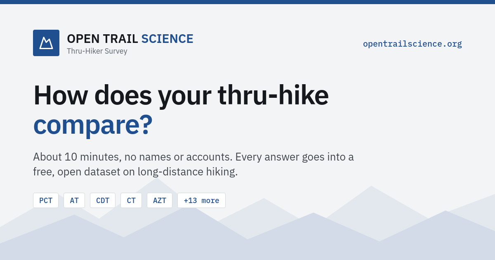

# Open Trail Science



Do low-cut shoes lead to more injuries? What's the optimized pack weight for maximal happiness? Everyone on trail has an answer, but hardly anyone has exact numbers.

[opentrailscience.org](https://opentrailscience.org) is a survey for anyone who has hiked a long-distance trail, finished or not. I never ask for your name or an annoying sign-up, and I blur the data a bit to prevent pinpointing a specific hiker, then publish every answer as an open dataset that anyone can download and play around with. Every hike gets us one step closer to some real answers!

## Why I built this

While planning for the PCT I of course watched all the mandatory indie-folk-infused journey videos, but I also really enjoyed looking at different statistics and surveys. These are great for answering how popular a specific trend is. I, however, also wanted to check for interesting correlations or try to model some predictions, and I could not find any large datasets to use. So I built one.

## A word on vibe coding

The entire codebase was written by AI.  I did, however, run extensive local testing and understand all backend functionality, which (to the best of my abilities) looks good. If you think I missed something, let me know at hello@opentrailscience.org.

## What's in here

- `public/`: the website and the survey
- `netlify/functions/`: the small server part that checks, blurs and stores the answers
- `public/lib/survey-schema.js`: every question, allowed answer and blurring rule in one place
- [docs/DATA_DICTIONARY.md](docs/DATA_DICTIONARY.md): every column of the dataset
- [docs/DEVELOPMENT.md](docs/DEVELOPMENT.md): how it all works, and how to deploy it

Want to try it locally? You only need Node.js 20 or newer:

```bash
npm install
npm run dev:offline   # http://127.0.0.1:3000 with synthetic hikers, no database needed
npm test
```

## The data

The dataset is free for everyone, as CSV and JSON on [opentrailscience.org/#download](https://opentrailscience.org/#download). How the answers are blurred and what is stored is explained on the [privacy page](https://opentrailscience.org/#privacy).

## License

The code is MIT ([LICENSE](LICENSE)), the dataset is public domain (CC0 1.0) and the fonts in `public/fonts/` come with their own SIL Open Font License.

## Contact

This is a one-person project, not a company. If you have any suggestions or questions, don't hesitate! hello@opentrailscience.org

For anything about your data: privacy@opentrailscience.org
